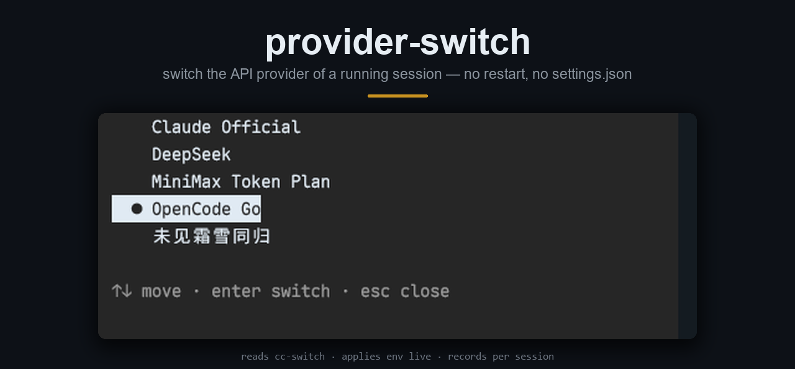

# provider-switch



**Switch the API provider of a running Claude Code session. No restart, no settings.json.**

[English](README.md) · [简体中文](README.zh-CN.md)

```
/plugin install provider-switch --marketplace moxisuki/provider-switch
```

Requires Node 22.5+ (for `node:sqlite`), Claude Code 2.1.318+, **and
[cc-switch](https://github.com/farion1231/cc-switch)** — see below.

## This mod depends on cc-switch

provider-switch does **not** create, edit or store providers of its own. It switches between the
providers **you have already configured in [cc-switch](https://github.com/farion1231/cc-switch)**.

- cc-switch must be installed, and must already have at least one Claude provider in its list
- the list is read from `~/.cc-switch/cc-switch.db` (`providers` where `app_type='claude'`), opened
  **read-only** — this mod never writes to it
- the shared base config (`common_config_claude`) is merged underneath each provider's `env`
- no cc-switch, no database, or an empty list: `/provider` says so and changes nothing
- adding, editing or removing a provider happens **in cc-switch**; `/provider reload` re-reads the list
- override the database path with `CC_SWITCH_DB` if yours is elsewhere

Without cc-switch there is nothing to switch — set the `ANTHROPIC_*` variables in `settings.json`
yourself instead.

## Use

```
/provider            # TUI picker: arrows, Enter, Esc
/provider list       # plain table
/provider reload     # re-read cc-switch
/provider deepseek   # by name
```

The choice applies to the **next request**; history, tools and transcript stay. Under the prompt, the
hint line ends with what is active:


## How it works

Provider settings are environment variables (`ANTHROPIC_BASE_URL`, `ANTHROPIC_API_KEY` /
`ANTHROPIC_AUTH_TOKEN`, the `ANTHROPIC_DEFAULT_*` aliases). The engine reads them per request, so the
mod rewrites them through `$.env.set` — including unsetting the keys the new provider does not name, so
a leftover `ANTHROPIC_API_KEY` cannot fight a new `ANTHROPIC_AUTH_TOKEN`.

| Where | What |
|---|---|
| cc-switch `cc-switch.db` | providers and the shared config, read **read-only** |
| `~/.provider-switch/state.db` | this mod's own store: the provider and model chosen per session id |
| `~/.claude/settings.json` | never written by this mod |

A resumed session restores its provider from the session id. Switching with `switchModel` on also runs
`/model <id>` — Claude Code records that as the default for new sessions, which is the engine's own
behaviour; turn `switchModel` off in `/config` to leave the model untouched.

## Limits

- Same protocol only: Anthropic Messages API. Bedrock, Vertex or a different API still needs a restart.
- Every key is spelled out in `hooks/lib/env.ts` — `$.env.set` accepts only string literals, so a
  variable cc-switch adds later is reported, not applied.
- In-flight requests finish on the old provider; prompt cache is lost once per switch.

## License

MIT
