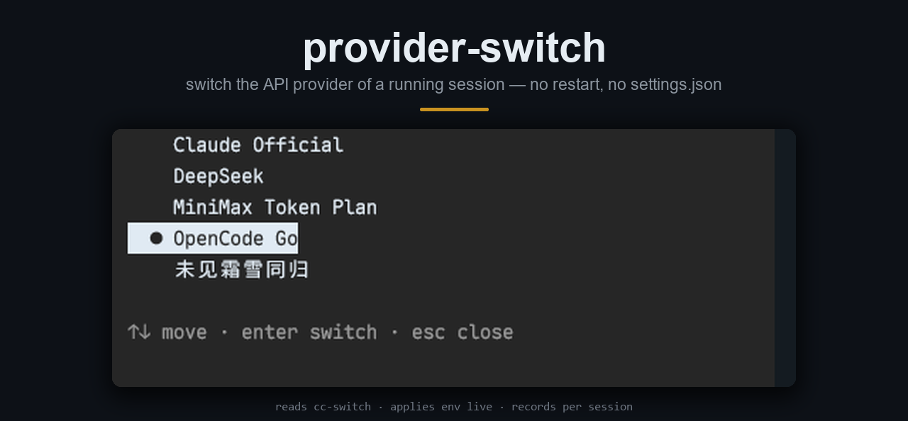

# provider-switch



**热切换正在运行的 Claude Code 会话的 API 供应商。不重启，不写 settings.json。**

[English](README.md) · [简体中文](README.zh-CN.md)

```
/plugin install provider-switch --marketplace moxisuki/provider-switch
```

需要 Node 22.5+（用 `node:sqlite`）、Claude Code 2.1.318+，**以及
[cc-switch](https://github.com/farion1231/cc-switch)** —— 见下。

## 本插件依赖 cc-switch

provider-switch **不创建、不修改、也不自己保存**供应商。它只在你**已经在 cc-switch 里配置好**的供应商之间切换。

- 必须先装 cc-switch，并且它的列表里至少有一个 Claude 供应商
- 列表从 `~/.cc-switch/cc-switch.db` 的 `providers`（`app_type='claude'`）读取，以**只读**方式打开——本插件从不写入
- cc-switch 的公共配置 `common_config_claude` 会垫在每个供应商的 `env` 之下
- 没装 cc-switch、库不存在或列表为空：`/provider` 会直接说明，不做任何改动
- 增、删、改供应商请在 cc-switch 里做；`/provider reload` 重新读列表
- 库不在默认位置时，用 `CC_SWITCH_DB` 指定

没有 cc-switch 就没有可切换的对象——那种情况下请直接手改 `settings.json` 里的 `ANTHROPIC_*` 变量。

## 用法

```
/provider            # TUI 选择器：方向键、回车、Esc
/provider list       # 纯文本列表
/provider reload     # 重新读取 cc-switch
/provider deepseek   # 按名字切
```

切换作用于**下一条请求**；会话历史、工具、上下文都保留。输入框下方的提示行末尾显示当前生效的供应商：


## 原理

供应商配置就是一组环境变量（`ANTHROPIC_BASE_URL`、`ANTHROPIC_API_KEY` / `ANTHROPIC_AUTH_TOKEN`、
`ANTHROPIC_DEFAULT_*` 别名）。引擎在每次请求时读取它们，所以本插件用 `$.env.set` 重写这些变量——
包括把新供应商没有声明的键 **unset**，避免残留的 `ANTHROPIC_API_KEY` 和新的 `ANTHROPIC_AUTH_TOKEN` 打架。

| 位置 | 内容 |
|---|---|
| cc-switch 的 `cc-switch.db` | 供应商列表与公共配置，**只读** |
| `~/.provider-switch/state.db` | 本插件自己的库：每个会话 id 选中的供应商与模型 |
| `~/.claude/settings.json` | 本插件从不写入 |

恢复会话时，会按会话 id 还原它选的供应商。`switchModel` 打开时，切换还会执行 `/model <id>`——
Claude Code 会把它记为新会话的默认模型，这是引擎自身的行为；不想动模型就在 `/config` 里关掉 `switchModel`。

## 限制

- 只支持同协议（Anthropic Messages API）。换 Bedrock、Vertex 或别的 API 仍需要重启。
- 每个变量名都在 `hooks/lib/env.ts` 里逐个写死——`$.env.set` 只接受字符串字面量，cc-switch 以后新增的变量会被报告而不是应用。
- 正在进行的请求仍走旧供应商；每次切换会丢一次 prompt cache。
- `/model` 的选择器列表是会话启动时按当时别名生成的，切换后会仍显示上一个供应商的模型；重启会话前请用 `/model <完整 id>` 直接指定。

## 许可

MIT
